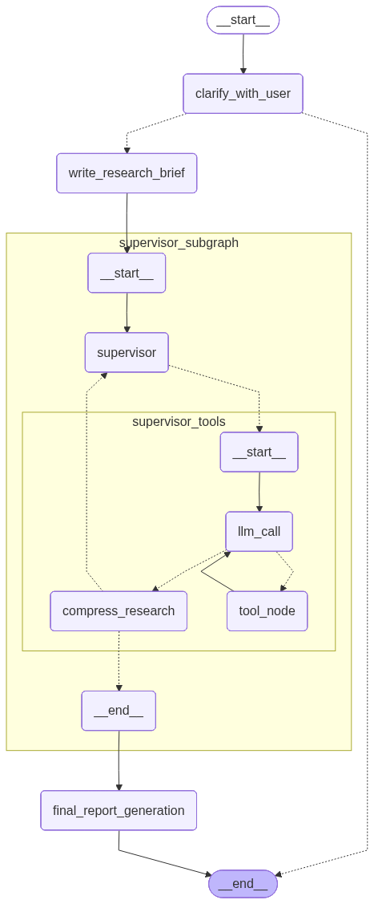
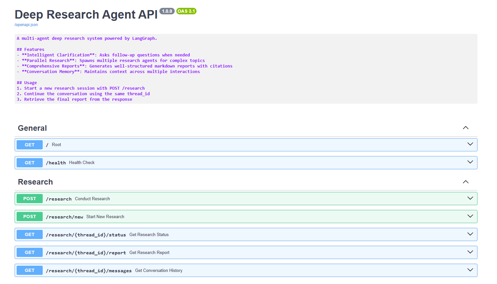
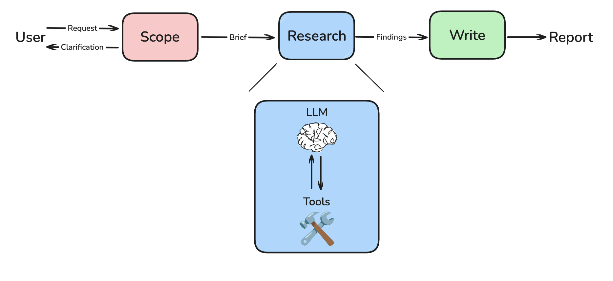

# 🧱 Deep Research Agent From Scratch

> A **production-ready, modular multi-agent research system** built with LangGraph and FastAPI. Conducts comprehensive research through parallel agent orchestration, synthesizes findings, and generates detailed reports with citations — inspired by [OpenAI Deep Research](https://openai.com/index/introducing-deep-research/), [Anthropic's Multi-Agent Research System](https://www.anthropic.com/engineering/built-multi-agent-research-system), and [Google Gemini Deep Research](https://gemini.google/overview/deep-research/).

[](https://www.python.org/downloads/)
[](https://github.com/langchain-ai/langgraph)
[](https://fastapi.tiangolo.com/)
[](https://groq.com/)
[](https://opensource.org/licenses/MIT)

---

## 👨‍💻 Project Maintainer & Portfolio Profile

* **Developer / Maintainer:** **Abhishek Kumar**
* **Affiliation:** Indian Institute of Technology Patna (IIT Patna)
* **Program:** 3rd Year Undergraduate, Department of Mechanical Engineering
* **GitHub Profile:** [@abhichaurasia42-sys](https://github.com/abhichaurasia42-sys)
* **Email:** abhichaurasia42@gmail.com
* **Core Domains:** Multi-Agent Orchestration, LangGraph State Machines, Asynchronous Distributed Systems, LLM Tool Calling

---

---

## 🎯 What This Project Demonstrates

| Skill | Implementation |
|-------|----------------|
| **Multi-Agent Architecture** | Supervisor pattern with parallel sub-agent orchestration |
| **Production API Design** | RESTful FastAPI with async/await, proper error handling |
| **Modular Code Organization** | Clean separation: states, prompts, tools, nodes, graphs |
| **Async Programming** | `asyncio.gather()` for concurrent research execution |
| **State Management** | Complex state flows with LangGraph checkpointing |
| **Context Engineering** | Token optimization, content compression, rate limiting |

---

## 🏗️ System Architecture

### High-Level Workflow


### FastAPI Integration


### Research Pipeline
```
┌──────────────────────────────────────────────────────────────────────────────┐
│                         DEEP RESEARCH PIPELINE                                │
├──────────────────────────────────────────────────────────────────────────────┤
│                                                                              │
│  📥 User Query                                                               │
│      │                                                                       │
│      ▼                                                                       │
│  ┌─────────────────────────────────────────────────────────────────────┐    │
│  │  PHASE 1: SCOPE                                                      │    │
│  │  ┌─────────────────┐    ┌─────────────────────────────────────┐     │    │
│  │  │ clarify_with_   │───▶│ write_research_brief                │     │    │
│  │  │ user            │    │ (Generate detailed research query)  │     │    │
│  │  └─────────────────┘    └─────────────────────────────────────┘     │    │
│  └─────────────────────────────────────────────────────────────────────┘    │
│      │                                                                       │
│      ▼                                                                       │
│  ┌─────────────────────────────────────────────────────────────────────┐    │
│  │  PHASE 2: PARALLEL RESEARCH (Multi-Agent)                           │    │
│  │                                                                      │    │
│  │  ┌─────────────────────────────────────────────────────────────┐    │    │
│  │  │                    SUPERVISOR AGENT                          │    │    │
│  │  │  • Analyzes research brief                                   │    │    │
│  │  │  • Delegates to specialized sub-agents                       │    │    │
│  │  │  • Aggregates findings                                       │    │    │
│  │  └──────────────────────────┬──────────────────────────────────┘    │    │
│  │                             │                                        │    │
│  │           ┌─────────────────┼─────────────────┐                     │    │
│  │           ▼                 ▼                 ▼                     │    │
│  │  ┌──────────────┐  ┌──────────────┐  ┌──────────────┐              │    │
│  │  │ Researcher 1 │  │ Researcher 2 │  │ Researcher 3 │              │    │
│  │  │              │  │              │  │              │              │    │
│  │  │ • Web Search │  │ • Web Search │  │ • Web Search │              │    │
│  │  │ • Summarize  │  │ • Summarize  │  │ • Summarize  │              │    │
│  │  │ • Compress   │  │ • Compress   │  │ • Compress   │              │    │
│  │  └──────────────┘  └──────────────┘  └──────────────┘              │    │
│  │           │                 │                 │                     │    │
│  │           └─────────────────┴─────────────────┘                     │    │
│  │                             │                                        │    │
│  │                             ▼                                        │    │
│  │                   Aggregated Research Notes                          │    │
│  └─────────────────────────────────────────────────────────────────────┘    │
│      │                                                                       │
│      ▼                                                                       │
│  ┌─────────────────────────────────────────────────────────────────────┐    │
│  │  PHASE 3: REPORT GENERATION                                          │    │
│  │  • Synthesize all findings                                           │    │
│  │  • Generate markdown with proper citations                           │    │
│  │  • Structure with headings and sources                               │    │
│  └─────────────────────────────────────────────────────────────────────┘    │
│      │                                                                       │
│      ▼                                                                       │
│  📄 Comprehensive Research Report                                            │
│                                                                              │
└──────────────────────────────────────────────────────────────────────────────┘
```

---

## 📁 Project Structure

```
Deep-Research-Agent/
│
├── 📄 app.py                          # FastAPI application entry point
├── 📄 requirements.txt                # Production dependencies
├── 📄 .env                            # Environment variables (API keys)
├── 📄 .gitignore                      # Git ignore rules
├── 📄 LICENSE                         # MIT License
│
├── 🖼️ Deep_Research_Agent_Workflow.png
├── 🖼️ Fastapi_flow.png
│
├── 📁 src/                            # Core modular implementation
│   ├── 📄 __init__.py                 # Package exports
│   │
│   ├── 📁 states/                     # State definitions
│   │   ├── 📄 __init__.py
│   │   ├── 📄 agent_state.py          # Main agent state (AgentState, AgentInputState)
│   │   ├── 📄 researcher_state.py     # Researcher state (ResearcherState)
│   │   ├── 📄 supervisor_state.py     # Supervisor state (SupervisorState)
│   │   └── 📄 schemas.py              # Pydantic schemas (ClarifyWithUser, Summary)
│   │
│   ├── 📁 prompts/                    # Prompt templates
│   │   ├── 📄 __init__.py
│   │   ├── 📄 scope_prompts.py        # User clarification prompts
│   │   ├── 📄 research_prompts.py     # Research agent prompts
│   │   ├── 📄 supervisor_prompts.py   # Supervisor coordination prompts
│   │   └── 📄 report_prompts.py       # Final report generation prompts
│   │
│   ├── 📁 llms/                       # LLM configuration
│   │   ├── 📄 __init__.py
│   │   ├── 📄 config.py               # API keys, model settings, limits
│   │   ├── 📄 models.py               # Model factory functions
│   │   └── 📄 utils.py                # Date formatting, path utilities
│   │
│   ├── 📁 tools/                      # Agent tools
│   │   ├── 📄 __init__.py
│   │   ├── 📄 search.py               # Tavily search with summarization
│   │   ├── 📄 think.py                # Strategic reflection tool
│   │   └── 📄 supervisor_tools.py     # ConductResearch, ResearchComplete
│   │
│   ├── 📁 nodes/                      # Workflow node functions
│   │   ├── 📄 __init__.py
│   │   ├── 📄 scope_nodes.py          # clarify_with_user, write_research_brief
│   │   ├── 📄 researcher_nodes.py     # llm_call, tool_node, compress_research
│   │   ├── 📄 supervisor_nodes.py     # supervisor, supervisor_tools (async)
│   │   └── 📄 report_nodes.py         # final_report_generation
│   │
│   └── 📁 graph/                      # LangGraph workflow definitions
│       ├── 📄 __init__.py
│       ├── 📄 researcher_graph.py     # Single researcher agent graph
│       ├── 📄 supervisor_graph.py     # Multi-agent supervisor graph
│       ├── 📄 full_agent.py           # Complete pipeline with checkpointing
│       └── 📄 utils.py                # Graph visualization utilities
│
├── 📁 notebooks/                      # Jupyter notebooks (learning/prototyping)
│   ├── 📓 1_scoping.ipynb             # User clarification & brief generation
│   ├── 📓 2_research_agent.ipynb      # Single research agent with tools
│   ├── 📓 3_research_supervisor.ipynb # Multi-agent supervisor pattern
│   └── 📓 4_full_agent.ipynb          # Complete integrated system
│
└── 📁 notebook_images/                # Diagram assets
    ├── 🖼️ research_agent.png
    ├── 🖼️ scoping_workflow.png
    └── 🖼️ scoping_evaluation.png
```

---

## 🚀 Quick Start

### Prerequisites

- **Python 3.11+**
- **API Keys:**
  - [Groq API Key](https://console.groq.com/) — LLM inference
  - [Tavily API Key](https://tavily.com/) — Web search

### Installation

```bash
# Clone the repository
git clone https://github.com/abhichaurasia42-sys/Deep-Research-Agent-From-Scratch.git
cd Deep-Research-Agent-From-Scratch

# Create virtual environment
python -m venv venv
venv\Scripts\activate  # Windows
# source venv/bin/activate  # macOS/Linux

# Install dependencies
pip install -r requirements.txt

# Configure environment
cp .env.example .env
# Edit .env with your API keys
```

### Run the API

```bash
# Start FastAPI server
uvicorn app:app --reload --host 0.0.0.0 --port 8000
```

Visit **http://localhost:8000/docs** for interactive API documentation.

---

## 📚 Notebooks

### 1️⃣ User Clarification and Brief Generation
**`notebooks/1_scoping.ipynb`**

**Purpose:** Clarify research scope and transform user input into structured research briefs

**Key Concepts:**
| Concept | Description |
|---------|-------------|
| User Clarification | Determines if additional context is needed using structured output |
| Brief Generation | Transforms conversations into detailed, actionable research questions |
| LangGraph Commands | Using `Command` system for flow control and state updates |
| Structured Output | Pydantic schemas (`ClarifyWithUser`, `ResearchQuestion`) for reliable decision making |

**Implementation Highlights:**
```python
# Two-step workflow with conditional routing
def clarify_with_user(state: AgentState) -> Command[Literal["write_research_brief", "__end__"]]:
    """Determine if clarification is needed before research."""
    if response.need_clarification:
        return Command(goto=END, update={"messages": [AIMessage(content=response.question)]})
    else:
        return Command(goto='write_research_brief', update={"messages": [AIMessage(content=response.verification)]})
```

**What You'll Learn:** State management, structured output patterns, conditional routing, human-in-the-loop design

---

### 2️⃣ Research Agent with Custom Tools
**`notebooks/2_research_agent.ipynb`**

**Purpose:** Build an iterative research agent using external search tools with context compression



**Key Concepts:**
| Concept | Description |
|---------|-------------|
| Agent Architecture | LLM decision node + tool execution node pattern |
| Tool Integration | Tavily search with automatic content summarization |
| Context Engineering | Webpage compression to manage token limits |
| ReAct Pattern | Iterative reasoning and acting loop |

**Implementation Highlights:**
```python
# Context Engineering - Summarize webpage content to reduce tokens
def summarize_webpage_content(webpage_content: str) -> str:
    """Compress webpage content while preserving key information."""
    MAX_INPUT_TOKENS = 28000  # Prevent Groq 413 errors
    # ... structured summarization with Summary schema

# Research Tools
@tool
def tavily_search(query: str) -> str:
    """Fetch and summarize web search results."""

@tool  
def think_tool(reflection: str) -> str:
    """Strategic reflection for research planning."""
```

**Agent Loop:**
```
┌──────────────────────────────────────────────────┐
│  START                                           │
│    ↓                                             │
│  llm_call (decide: search or answer?)            │
│    ↓                                             │
│  ┌─────────────────────────────────────────┐     │
│  │ tool_calls?  ──YES──▶ tool_node         │     │
│  │      │                    ↓             │     │
│  │      │               execute tools      │     │
│  │      │                    ↓             │     │
│  │      └────────────────────┘             │     │
│  │                                         │     │
│  │      NO                                 │     │
│  │       ↓                                 │     │
│  └───▶ compress_research                   │     │
│              ↓                             │     │
│           END                              │     │
└──────────────────────────────────────────────────┘
```

**What You'll Learn:** Agent patterns, tool integration, search optimization, context compression strategies

---

### 3️⃣ Research Supervisor (Multi-Agent)
**`notebooks/3_research_supervisor.ipynb`**

**Purpose:** Multi-agent coordination for complex, parallelizable research tasks

**Key Concepts:**
| Concept | Description |
|---------|-------------|
| Supervisor Pattern | Coordination agent delegates to specialized worker agents |
| Parallel Research | Concurrent execution using `asyncio.gather()` |
| Context Isolation | Separate context windows prevent cross-contamination |
| Research Delegation | Structured tools (`ConductResearch`, `ResearchComplete`) |

**Multi-Agent Architecture:**
```
                    ┌─────────────────────┐
                    │   SUPERVISOR        │
                    │                     │
                    │ • Analyze brief     │
                    │ • Plan delegation   │
                    │ • Aggregate results │
                    └──────────┬──────────┘
                               │
           ┌───────────────────┼───────────────────┐
           ↓                   ↓                   ↓
    ┌──────────────┐   ┌──────────────┐   ┌──────────────┐
    │ Sub-Agent 1  │   │ Sub-Agent 2  │   │ Sub-Agent 3  │
    │              │   │              │   │              │
    │ Topic A      │   │ Topic B      │   │ Topic C      │
    │ research     │   │ research     │   │ research     │
    └──────────────┘   └──────────────┘   └──────────────┘
           │                   │                   │
           └───────────────────┴───────────────────┘
                               ↓
                    ┌─────────────────────┐
                    │  Aggregated Notes   │
                    └─────────────────────┘
```

**Implementation Highlights:**
```python
# Supervisor Tools for Research Delegation
@tool
class ConductResearch(BaseModel):
    """Delegate research task to a specialized sub-agent."""
    research_topic: str = Field(description="Topic to research in high detail")

@tool
class ResearchComplete(BaseModel):
    """Signal that research is complete."""
    pass

# Parallel Research Execution
async def supervisor_tools(state: SupervisorState):
    """Execute parallel research with multiple sub-agents."""
    coros = [
        researcher_agent.ainvoke({
            "researcher_messages": [HumanMessage(content=tool_call["args"]["research_topic"])]
        }) 
        for tool_call in conduct_research_calls
    ]
    results = await asyncio.gather(*coros)  # True concurrency
```

**Configuration:**
```python
max_researcher_iterations = 6   # Prevent infinite loops
max_concurrent_researchers = 3  # Parallel agent limit
```

**What You'll Learn:** Multi-agent patterns, parallel async orchestration, research coordination, delegation strategies

---

### 4️⃣ Full Multi-Agent Research System
**`notebooks/4_full_agent.ipynb`**

**Purpose:** Complete end-to-end research system integrating all components

**Complete Pipeline:**
```
┌─────────────────────────────────────────────────────────────────┐
│                    FULL AGENT WORKFLOW                          │
├─────────────────────────────────────────────────────────────────┤
│                                                                 │
│  User Input: "Compare Gemini to OpenAI Deep Research agents"   │
│                            ↓                                    │
│  ┌─────────────────────────────────────────────────────────┐   │
│  │ PHASE 1: SCOPE                                          │   │
│  │  • clarify_with_user (ask clarifying questions)         │   │
│  │  • write_research_brief (generate detailed brief)       │   │
│  └─────────────────────────────────────────────────────────┘   │
│                            ↓                                    │
│  ┌─────────────────────────────────────────────────────────┐   │
│  │ PHASE 2: RESEARCH                                       │   │
│  │  • supervisor (coordinate research strategy)            │   │
│  │  • supervisor_tools (delegate to sub-agents)            │   │
│  │      ├── researcher_agent (Gemini research)             │   │
│  │      ├── researcher_agent (OpenAI research)             │   │
│  │      └── researcher_agent (Comparison research)         │   │
│  └─────────────────────────────────────────────────────────┘   │
│                            ↓                                    │
│  ┌─────────────────────────────────────────────────────────┐   │
│  │ PHASE 3: WRITE                                          │   │
│  │  • final_report_generation (synthesize & format)        │   │
│  │  • Output: Comprehensive markdown report with citations │   │
│  └─────────────────────────────────────────────────────────┘   │
│                                                                 │
└─────────────────────────────────────────────────────────────────┘
```

**State Schema:**
```python
class AgentState(MessagesState):
    """Complete state for the multi-agent research system."""
    
    research_brief: Optional[str]                    # Generated research question
    supervisor_messages: Sequence[BaseMessage]       # Supervisor coordination
    raw_notes: Annotated[List[str], operator.add]    # Unprocessed research notes
    notes: Annotated[List[str], operator.add]        # Processed notes
    final_report: str                                # Final markdown report
```

**Usage Example:**
```python
from langchain_core.messages import HumanMessage
from langgraph.checkpoint.memory import InMemorySaver

# Initialize with checkpointing for conversation persistence
checkpointer = InMemorySaver()
full_agent = deep_researcher_builder.compile(checkpointer=checkpointer)

# Run research
thread = {"configurable": {"thread_id": "1", "recursion_limit": 50}}
result = await full_agent.ainvoke({
    "messages": [HumanMessage(content="Compare Gemini to OpenAI Deep Research agents.")]
}, config=thread)

# Display final report
from IPython.display import Markdown
Markdown(result["final_report"])
```

**What You'll Learn:** System architecture, subgraph composition, end-to-end workflows, production patterns

---

## 🔌 API Reference

### Endpoints

| Method | Endpoint | Description |
|--------|----------|-------------|
| `GET` | `/` | API information |
| `GET` | `/health` | Health check with service status |
| `POST` | `/research` | Conduct research (supports conversation) |
| `POST` | `/research/new` | Start fresh research session |
| `GET` | `/research/{thread_id}/status` | Get research status |
| `GET` | `/research/{thread_id}/report` | Retrieve final report |
| `GET` | `/research/{thread_id}/messages` | Get conversation history |

### Example Usage

```python
import requests

# Start new research
response = requests.post("http://localhost:8000/research", json={
    "query": "Compare OpenAI and Anthropic approaches to AI safety",
    "recursion_limit": 50
})

result = response.json()
print(f"Thread ID: {result['thread_id']}")
print(f"Status: {result['status']}")

# If clarification needed, continue conversation
if result['status'] == 'clarification_needed':
    response = requests.post("http://localhost:8000/research", json={
        "query": "Focus on their published research and safety frameworks",
        "thread_id": result['thread_id']
    })

# Get final report
if result['status'] == 'complete':
    print(result['final_report'])
```

### cURL Examples

```bash
# Health check
curl http://localhost:8000/health

# Start research
curl -X POST http://localhost:8000/research \
  -H "Content-Type: application/json" \
  -d '{"query": "What are the latest developments in quantum computing?"}'

# Get report
curl http://localhost:8000/research/{thread_id}/report
```

---

## 🧠 Technical Deep Dive

### Multi-Agent Orchestration

The system uses a **supervisor pattern** where a coordinator agent delegates tasks to specialized research agents:

```python
# Parallel research execution with asyncio
async def supervisor_tools(state: SupervisorState):
    conduct_research_calls = [...]  # Extract from tool calls
    
    # Launch parallel research agents
    coros = [
        researcher_agent.ainvoke({
            "researcher_messages": [HumanMessage(content=topic)],
            "research_topic": topic
        })
        for topic in research_topics
    ]
    
    # True concurrency - all agents run simultaneously
    results = await asyncio.gather(*coros)
    
    # Aggregate findings
    return aggregate_research(results)
```

### Context Engineering

Token limits are managed through intelligent content compression:

```python
# Webpage summarization to reduce tokens
def summarize_webpage_content(content: str) -> str:
    MAX_INPUT_TOKENS = 28000
    structured_model = model.with_structured_output(Summary)
    
    summary = structured_model.invoke([
        HumanMessage(content=SUMMARIZE_PROMPT.format(
            webpage_content=content[:MAX_INPUT_TOKENS * 4]
        ))
    ])
    
    return f"<summary>{summary.summary}</summary>"

# Research compression before report generation
def compress_research(state: ResearcherState) -> dict:
    # Preserve citations while reducing volume
    return {
        "compressed_research": synthesize(state["researcher_messages"]),
        "raw_notes": extract_notes(state["researcher_messages"])
    }
```

### State Management

LangGraph's state system enables complex workflows:

```python
class AgentState(MessagesState):
    """Main workflow state with type-safe annotations."""
    
    research_brief: Optional[str]
    supervisor_messages: Annotated[Sequence[BaseMessage], add_messages]
    raw_notes: Annotated[List[str], operator.add]  # Accumulator pattern
    notes: Annotated[List[str], operator.add]
    final_report: str
```

---

## ⚙️ Configuration

### Environment Variables

```env
# Required
GROQ_API_KEY=gsk_...
TAVILY_API_KEY=tvly-...

# Optional - LangSmith Tracing
LANGCHAIN_API_KEY=lsv2_...
LANGCHAIN_TRACING_V2=true
LANGCHAIN_PROJECT=deep_research
```

### Model Configuration

```python
# src/llms/config.py
MODEL_NAME = "meta-llama/llama-4-scout-17b-16e-instruct"
TEMPERATURE = 0
MAX_TOKENS = 8192

# Research limits
MAX_RESEARCHER_ITERATIONS = 6
MAX_CONCURRENT_RESEARCHERS = 3
```

---

## 📊 Key Design Decisions

| Decision | Rationale |
|----------|-----------|
| **Modular Architecture** | Enables testing, reuse, and easy modification of components |
| **Factory Functions for Models** | Allows swapping LLM providers without code changes |
| **Async Throughout** | Maximizes throughput for I/O-bound research operations |
| **Checkpointing** | Enables conversation continuity and crash recovery |
| **Structured Outputs** | Pydantic schemas ensure reliable agent decisions |
| **Prompt Separation** | Prompts as configuration, not hardcoded in logic |

---

## 🎯 Key Learning Outcomes

| Category | Skills Acquired |
|----------|-----------------|
| **Structured Output** | Pydantic schemas for reliable AI decision making, JSON schema validation |
| **Agent Patterns** | ReAct loops, supervisor delegation, multi-agent coordination |
| **Async Orchestration** | Strategic use of `asyncio.gather()` for parallel vs sequential execution |
| **Context Engineering** | Token management, content compression, rate limit handling |
| **Search Integration** | Tavily API, content summarization, deduplication |
| **State Management** | Complex state flows across subgraphs and nodes |
| **Workflow Design** | LangGraph patterns, conditional routing, human-in-the-loop |
| **Production Patterns** | Checkpointing, error handling, configuration management |

---

## 🔮 Roadmap

- [ ] **Streaming Responses** — Real-time research progress via SSE
- [ ] **Persistent Storage** — PostgreSQL/Redis for production checkpointing
- [ ] **Web UI** — React frontend for interactive research
- [ ] **Academic Search** — arXiv, PubMed, Google Scholar integration
- [ ] **Evaluation Suite** — Automated research quality metrics
- [ ] **Docker Deployment** — Containerized production setup

---

## 📚 References

- [OpenAI Deep Research](https://openai.com/index/introducing-deep-research/)
- [Anthropic Multi-Agent Research System](https://www.anthropic.com/engineering/built-multi-agent-research-system)
- [Google Gemini Deep Research](https://gemini.google/overview/deep-research/)

---

## 👨‍💻 Maintainer & Acknowledgements

<div align="center">

### Maintained & Studied by **Abhishek Kumar**
*3rd Year Mechanical Engineering Student, IIT Patna*

[](https://github.com/abhichaurasia42-sys)

<br/>

*Originally designed & created by [Brijesh Rakhasiya](https://github.com/BrijeshRakhasiya/Deep-Research-Agent-From-Scratch)*

</div>

---

<p align="center">
  <b>⭐ Star this repo if you find it helpful!</b>
</p>

